# Website Docs

This folder contains the long-lived rule graph for the site.

Use these documents when you need to answer:
- what the site should become,
- what standards must remain true,
- what patterns are allowed or discouraged,
- and how quality is measured.

## What belongs here
- long-lived architecture rules,
- UX and layout patterns,
- content and sidebar policy,
- and quality bar and KPI guidance.

## What does not belong here
- project plans,
- roadmap items,
- execution trackers,
- epics,
- features,
- user stories,
- or task lists.

Those belong in `../projects/`.

## Doc graph

```mermaid
flowchart TD
	Root[docs/README.md] --> System[system-design.md]
	Root --> Tenets[website-tenets.md]
	Root --> UX[ux-patterns-and-design-system.md]
	Root --> Matrix[page-responsibility-matrix.md]
	Root --> Checklist[page-responsibility-checklist.md]
	Root --> Routes[route-map-and-navigation-contract.md]
	Root --> Acceptance[core-page-acceptance-checklist.md]
	Root --> Stack[stack-and-design-decisions.md]
	Root --> Content[content-and-sidebar-strategy.md]
	Root --> Quality[performance-indicators.md]
	Root --> Schema[work-item-standard.md]

	Root --> Projects[../projects/README.md]
```

## Operational skills
- `.github/skills/docs-authoring/SKILL.md`: use when writing, revising, or reviewing docs.
- `.github/skills/project-workspace-management/SKILL.md`: use when managing project workspaces, roadmaps, trackers, reference notes, or work items.
- `.github/skills/system-design/SKILL.md`: use when defining or revising site architecture, page responsibilities, navigation, phased system growth, or cross-page structural rules.
- `.github/skills/page-creation-and-review/SKILL.md`: use when creating a new page or reviewing whether a page should exist, what it must include, and how it fits the responsibility matrix.
- `.github/skills/ux-patterns/SKILL.md`: use when defining or revising typography, spacing, colors, layout rhythm, component families, reading flow, or page-level UX patterns.
- `.github/skills/stack-and-design-decisions/SKILL.md`: use when defining or revising implementation stack choices, component sourcing rules, state rules, or stable styling direction.
- `.github/skills/content-and-sidebar-strategy/SKILL.md`: use when defining or revising sidebar placement, suggestions, ad zones, affiliate strategy, or monetization-safe reading flows.
- `.github/skills/performance-indicators/SKILL.md`: use when defining or revising the quality bar, KPIs, launch gate, or review cadence used to evaluate the rebuild.
- `.github/skills/work-item-standard/SKILL.md`: use when defining or revising project item front matter, item taxonomy, body expectations, or placement rules for epics, features, stories, and tasks.

The docs remain the source of truth for content. The skills are the source of truth for how to work with that content.

## Document roles
- `website-tenets.md`: non-negotiable rules about what this website is, what it should protect, and what future work must not compromise.
- `system-design.md`: target architecture, page model, navigation approach, and phased rebuild system design.
- `page-responsibility-matrix.md`: page-level responsibility contract derived from tenets and system design, including must-include and must-avoid rules.
- `page-responsibility-checklist.md`: fast review checklist derived from the responsibility matrix for implementation and review passes.
- `route-map-and-navigation-contract.md`: target route map and the navigation rules every page must follow.
- `core-page-acceptance-checklist.md`: per-page acceptance gate that defines when a core page is allowed to ship.
- `ux-patterns-and-design-system.md`: design language, component behavior, layout rules, and content UX patterns.
- `stack-and-design-decisions.md`: implementation stack, version policy, component sourcing rules, and durable styling guidance.
- `content-and-sidebar-strategy.md`: article page behavior, ad slots, suggested posts, sidebar rules, and monetization-safe layout guidance.
- `performance-indicators.md`: quality bar, KPI definitions, launch gate, and review cadence.
- `work-item-standard.md`: front matter schema for project epics, features, user stories, and tasks.

## Working rule
If a change affects UX, page structure, monetization behavior, or operating rules that should continue after the rebuild, update the relevant document in this folder before or alongside implementation.
