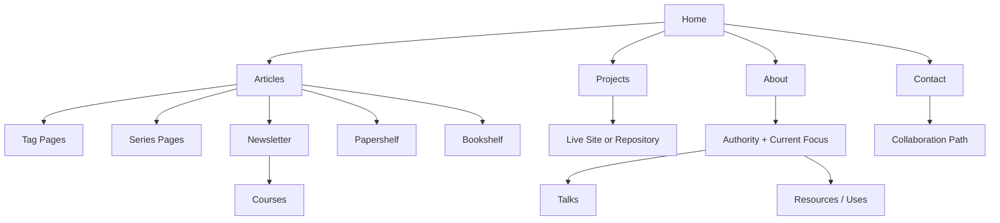

# Rebuild System Design

## Goal
Rebuild the site as a developer-first knowledge platform that starts simple but can grow into a durable content and trust system.

## Primary outcomes
The rebuilt site should:
- feel modern, elegant and calm,
- be easy for developers to read and trust,
- support long-form article reading,
- support secondary learning surfaces over time,
- support ads and monetization without damaging credibility,
- and remain simple enough to maintain.

## System-level design constraints
These constraints should be treated as part of the system design, not as optional polish:
- define a clear typography hierarchy for reading, proof and conversion modules,
- define a consistent spacing system before template work scales,
- keep color accents restrained and editorial rather than loud,
- treat navbar, footer, article cards, project cards, CTA blocks and sidebar modules as reusable product primitives,
- and treat accessibility, SEO metadata, structured data, sitemap coverage, robots rules and `llms.txt` as required system surfaces.

## Fixed top navigation
Keep these top-level tabs:
- Articles
- Projects
- Bookshelf
- About
- Contact

These are the stable public anchors of the site.

## Secondary surfaces to grow over time
These should not necessarily become top-nav items immediately, but the system should support them cleanly:
- Newsletter
- Papershelf
- Talks
- Courses
- Collaborate
- Uses / Resources

## Site architecture model

## Responsibility contract
Use `page-responsibility.md` as the canonical implementation contract for page-level ownership.

`system-design.md` defines architectural direction.
`page-responsibility.md` defines what each surface must include, must avoid and explicitly own.

## Core page responsibilities
### Home
Purpose:
- orient first-time visitors,
- route repeat visitors quickly,
- and surface the strongest proof of value.

Should include:
- concise hero and positioning,
- current focus,
- featured articles,
- featured projects,
- trust signals,
- newsletter call-to-action,
- and optional module links to Papershelf or Bookshelf once launched.

Should not become:
- a dense portal,
- an everything page,
- or a heavy ad surface.

### Articles
Purpose:
- main traffic and teaching engine.

Should include:
- archive view,
- featured content,
- topic and tag navigation,
- and strong internal related-content links.

Article pages must support:
- good reading flow,
- optional sidebars on large screens,
- suggested posts by tag or category,
- newsletter CTA,
- and monetization slots that do not interrupt comprehension.

### Projects
Purpose:
- visible proof of execution quality.

The projects index is the terminal proof surface. There are no per-project detail routes, so each project renders inline as a case row: a featured tier with screenshots for the flagship work and a compact tier for the rest. Titles and actions link out to the live site or source repository.

Each project should answer, inline:
- what problem it solves,
- what was shipped,
- and what it is built with.

Deeper case-study writing lives in related articles, cross-linked from the row. A dedicated `/projects/[slug]` route can return later if a single project needs a full write-up.

### Tools
The `/tools/` index links to usable browser utilities. Tool pages live at descriptive
`/tools/<name>/` routes. They are working interfaces, not project case studies.
Projects and the footer provide discovery; the fixed top navigation stays unchanged.
Text cleanup runs locally without storing or uploading input. Explain the exact
character rules and limitations. Do not claim guaranteed AI watermark removal.
The AI Text Cleaner builds on Exort's character rules. Special spaces become
ordinary spaces instead of being deleted, so words do not join. Conservative
cleanup is the default: C0 controls except tab, LF and CR, plus DEL and special spaces.
The plain-text preset also replaces dash variations and curly quotes. Removing
zero-width spaces, BOM, joiners, prime symbols, word joiners, soft hyphens,
text-direction controls and emoji requires separate opt-ins. Detection does not
imply removal. Recognized emoji are complete sequences and remain intact unless
emoji removal is selected. No blanket Unicode format-character deletion is allowed.

Use native text areas, not Monaco. The inspection view exposes names, code points,
original positions and selected actions without inserting markers into the actual
text. The change report groups actual edits and provides occurrence-based highlights
and previous/next navigation. Preserve source and output offsets for deletions,
repeated text and multi-code-point sequences. Invalidate stale reports when input
or options change. Markdown/code protection is not part of this tool's current
contract: selected rules apply inside code too. Pasted text is never persisted.

Tool detail SEO must name the actual tasks and keep the canonical route stable.
Use a descriptive title, a task-specific description and a dedicated social image.
Connect the WebPage, WebApplication, breadcrumbs and author with stable JSON-LD
identifiers. Describe only real features and the actual free price. AI Text Cleaner
does not use rating or review markup. Include short instructions and cleanup
examples in static HTML. Verify example outputs against the real cleanup engine.

### About
Purpose:
- trust and orientation.

Should explain:
- who you are,
- what topics you cover,
- what you are currently building or learning,
- and why readers should trust your perspective.

This page should feel editorial first. A skills grid is allowed as a contained, themed secondary section (design-system tokens, not a loud icon wall), but identity, current focus and proof lead.

### Contact
Purpose:
- clean entry point for conversations.

Should support:
- general contact,
- collaboration intent,
- speaking interest,
- feedback,
- and future sponsorship inquiries.

## Rebuild phases
### Phase 1: Foundation
Scope:
- homepage redesign,
- article archive redesign,
- article page template redesign,
- projects listing cleanup,
- about and contact polish,
- and Priority 0 technical fixes.

### Phase 2: Trust loop support
Scope:
- newsletter page,
- tag and series pages,
- better project case-study format,
- Papershelf and Bookshelf system scaffolding.

### Phase 3: Growth surfaces
Scope:
- Talks page,
- Collaborate page,
- Resources / Uses page,
- waitlist or course landing pages.

### Phase 4: Packaging
Scope:
- course surfaces,
- downloadable learning assets,
- more explicit monetization flows.

## Rebuild timeline suggestion
### Week 1
- positioning, content model, layout system, wireframes.

### Week 2
- design system and article/project templates.

### Week 3
- implement homepage, articles index, article template.

### Week 4
- implement projects, about, contact, footer, supporting components.

### Week 5
- QA, accessibility, performance, SEO, ad-safe layout validation and launch.

## AI agent implementation rule
Any agent implementing UI should verify:
- page purpose,
- content density,
- trust impact,
- and monetization side effects
before shipping layout changes.
