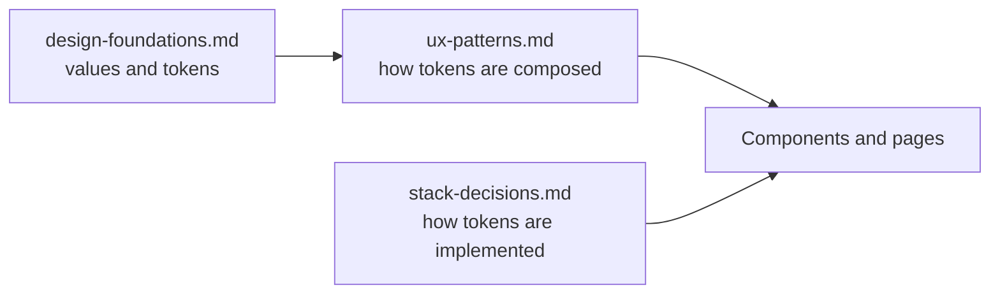

# Design Foundations

This document is the source of truth for the site's design **values**: the theme decision and the design tokens (color, typography, spacing, radius, borders, elevation, motion) that every page and component consumes.

It is intentionally long-lived. If any token or theme decision changes, update this file.

## Scope boundary
This doc answers "what are the raw design values." It does not decide page structure or how tokens are composed.

- `design-foundations.md` (this file): color, type, spacing, radius, elevation, motion, theme.
- `ux-patterns.md`: layout patterns, component families, reading flow, sidebar policy.
- `../engineering/stack-decisions.md`: how these tokens are implemented (Tailwind CSS theme + CSS variables, shadcn/ui).

## Chosen aesthetic: Editorial Typographic
The site uses one named direction: **Editorial Typographic**, a Swiss / International Typographic style carried by the clarity discipline of gov.uk.

What it means:
- text-first, high-contrast, clarity over decoration,
- near-black text on white, one strong brand color, blue links and a warm secondary,
- separation by hairline borders and spacing rather than shadows,
- typography and hierarchy do the design work, not chrome,
- tighter spacing to start: use the calm end of the whitespace scale and open it up only where reading needs it.

What it is explicitly **not**:
- not Brutalism (raw, loud, high-contrast blocky slabs, exposed structure),
- not heavy Material (elevation-driven surfaces, saturated fills, motion-forward affordances),
- not startup landing hype (loud gradients, badge walls, aggressive CTAs).

Inspiration is gov.uk and canada.ca clarity: strong contrast, obvious underlined links, bold focus and functional components. We borrow the discipline, not the components.

## Token model
- Tokens are expressed as **CSS custom properties** on `:root` (light) and `.dark` (dark), surfaced through the Tailwind theme.
- Components reference **semantic tokens** (never raw hex). Editorial utilities: `bg-paper`, `bg-surface`, `text-ink`, `text-body`, `text-subtle`, `text-brand`.
- shadcn/ui utilities alias the same palette so its components work unchanged. Note the two overlaps: the red brand is `primary` (use `text-primary` / `bg-primary`, not `text-accent`), and muted text is `muted-foreground` (use `text-muted-foreground`, not `text-muted`). Links use `text-link` (blue).
- Light mode is the launch baseline. Dark mode tokens are defined here now but ship in a later phase.
- Implementation wiring lives in `src/app/globals.css` (Tailwind v4 `@theme`); see `../engineering/stack-decisions.md`.

## Color

### Principles
- Neutrals carry the layout. The brand (red) marks identity and primary actions, blue marks links, amber is the secondary highlight.
- Prefer borders and spacing over fills and shadows for separation.
- Contrast runs high on purpose: near-black text on white. All text/background pairings must meet **WCAG AA** (4.5:1 body, 3:1 large/UI).

### Semantic tokens
Brand is Tailwind red, links are Tailwind blue, secondary is Tailwind amber, neutrals are Tailwind zinc. Source: `../brand/visual-identity.md`.

| Token | Light | Dark | Usage |
|---|---|---|---|
| `paper` (background) | `#ffffff` | `#09090b` | Page background |
| `surface` | `#f4f4f5` | `#18181b` | Cards and raised panels |
| `surface-strong` | `#e4e4e7` | `#27272a` | Hover or active panel, code block background |
| `border` | `#d4d4d8` | `#27272a` | Hairline dividers and card borders |
| `ink` (text strong) | `#18181b` | `#fafafa` | Headings and primary text |
| `body` (text) | `#3f3f46` | `#d4d4d8` | Body copy |
| `muted` (text) | `#71717a` | `#a1a1aa` | Meta, captions, secondary text |
| `subtle` (text) | `#a1a1aa` | `#71717a` | Disabled and faint labels |
| `brand` (primary) | `#b91c1c` | `#ef4444` | Wordmark, primary buttons, brand accent (red-700 / red-500) |
| `brand-hover` | `#991b1b` | `#f87171` | Hover state for brand actions |
| `secondary` | `#fbbf24` | `#fbbf24` | Secondary buttons and highlights (amber-400) |
| `link` | `#1d4ed8` | `#60a5fa` | Inline and content links (blue-700 / blue-400) |
| `focus` | `#2563eb` | `#60a5fa` | Bold focus outline (blue-600 / blue-400) |

Brand red is reserved for identity and primary actions. Use `red-700` for brand text and buttons on white; avoid `red-600` as text (just under AA).

### Link behavior
Links use one blue. There is no separate hover or visited color yet.

| State | Behavior |
|---|---|
| Default | blue-700, underlined at 1px, offset from the text |
| Hover | same color, underline thickens to 3px |
| Visited | deferred: same as default for now |
| Focus | 3px blue outline (`focus`), 2px offset, never removed |

When hover and visited colors return, keep them in one blue family.

### Buttons
Buttons follow the [gov.uk button pattern](https://design-system.service.gov.uk/components/button/): **square corners**, sentence-structured actions, and a **2px bold bottom edge**. Following gov.uk, the edge is always a **darker shade of the button's own fill**, never a contrasting colour: the red primary takes a dark-red edge, the light outline button takes a grey edge. On press the button nudges down 2px and the edge collapses; hover darkens the fill.

| Variant | Fill | Text | Bottom edge (2px) |
|---|---|---|---|
| Primary (default) | `brand` (red-700) | white | red-900 (`#7f1d1d`) |
| Secondary | `secondary` (amber-400) | ink | amber-700 (`#b45309`) |
| Outline | transparent (light), border | ink | neutral (zinc-400, `#a1a1aa`) |

We keep the red brand rather than gov.uk green, and use the site-wide blue focus ring rather than the gov.uk yellow focus.

### Semantic status
| Token | Light | Dark | Usage |
|---|---|---|---|
| `success` | `#059669` | `#34d399` | Confirmations |
| `warning` | `#d97706` | `#fbbf24` | Cautions |
| `danger` | `#e11d48` | `#fb7185` | Errors and destructive actions (rose, kept distinct from brand red) |
| `info` | `#1d4ed8` | `#60a5fa` | Reuses the link blue |

Danger uses rose so it stays distinct from the brand red. A dedicated danger scale can be finalized later.

## Typography

### Font families
Source: `../brand/visual-identity.md`. All three are open-source and on Google Fonts.

| Role | Family | Fallback | Where it is used |
|---|---|---|---|
| Headings and display | `Fraunces` | `Georgia, serif` | Headings, nav, the "GK" wordmark, prominent labels |
| Body and UI text | `Poppins` | `system-ui, sans-serif` | Article body and lead, captions, meta, general UI text |
| Code | `Fira Code` | `ui-monospace, monospace` | Inline code and code blocks |

Rule: **headings use Fraunces (a display serif), reading and UI text use Poppins, code uses Fira Code.**

### Type scale and element mapping
Base is 16px = `1rem`. This directly answers "which element uses which font/size."

| Element | Font | Size | Line height | Weight | Tracking |
|---|---|---|---|---|---|
| Display / `h1` | Fraunces | 2.5rem / 40px | 1.1 | 700 | -0.02em |
| `h2` | Fraunces | 1.875rem / 30px | 1.15 | 700 | -0.01em |
| `h3` | Fraunces | 1.5rem / 24px | 1.25 | 700 | normal |
| `h4` | Fraunces | 1.25rem / 20px | 1.3 | 700 | normal |
| `h5` | Fraunces | 1.125rem / 18px | 1.4 | 700 | normal |
| `h6` / eyebrow | Fraunces | 0.8125rem / 13px | 1.4 | 700 | 0.06em, uppercase |
| Article lead | Poppins | 1.25rem / 20px | 1.6 | 400 | normal |
| Article body | Poppins | 1.125rem / 18px | 1.7 | 400 | normal |
| UI / base body | Poppins | 1rem / 16px | 1.6 | 400 | normal |
| Small | Poppins | 0.875rem / 14px | 1.5 | 400 | normal |
| Caption / meta | Poppins | 0.8125rem / 13px | 1.4 | 400 | normal |
| Blockquote | Poppins | 1.125rem / 18px | 1.7 | 400 italic | normal |
| Inline code | Fira Code | 0.9375rem / 15px | inherit | 400 | normal |

### Reading measure
- Long-form article body: **65–72ch** max width.
- UI content columns follow the layout patterns in `ux-patterns.md`.

## Spacing
Base unit is **4px**. This scale intentionally matches Tailwind's default spacing scale, so we align with the framework rather than fight it.

| Token | Value | Typical use |
|---|---|---|
| `space-1` | 4px | Icon gaps, tight inline |
| `space-2` | 8px | Chip/label padding |
| `space-3` | 12px | Compact control padding |
| `space-4` | 16px | Default control padding, mobile gutter |
| `space-5` | 20px | Card inner padding (compact) |
| `space-6` | 24px | Card inner padding (default), desktop gutter |
| `space-8` | 32px | Between related blocks |
| `space-12` | 48px | Section rhythm (min) |
| `space-16` | 64px | Section rhythm (default) |
| `space-24` | 96px | Major section break |

Guidance:
- Component internal padding: `space-3` to `space-6`.
- Section vertical rhythm: `space-12` to `space-24`.
- Page gutters: `space-4` (mobile) to `space-6`/`space-8` (desktop).

## Radius
Corners are **square** across the site, matching the gov.uk-inspired editorial system. Rounding is structural noise here, so it is removed. A single token, `--radius` (set to `0`), drives the `sm`/`md`/`lg` steps.

| Token | Value | Use |
|---|---|---|
| `radius-sm` / `radius-md` / `radius-lg` | 0 | Buttons, cards, inputs, navbar, tags — everything |
| `radius-full` | 9999px | Reserved for genuinely circular elements (avatars) |

Everything reads square. To reintroduce a faint rounding, raise `--radius` (for example to `2px`); the sm/md/lg steps follow it. Avoid returning to visibly rounded surfaces.

## Borders and dividers
- Hairline width: **1px**, using the `border` token.
- Prefer a border over a shadow to separate reading surfaces.
- Reserve heavier separation for genuinely layered UI (menus, dialogs).

## Elevation and shadow
Shadows are restrained. Borders do most separation work.

| Token | Use |
|---|---|
| `shadow-none` | Default for cards and reading surfaces |
| `shadow-sm` | Subtle lift on hover, popovers |
| `shadow-md` | Dropdowns, menus |
| `shadow-lg` | Dialogs, modals |

All shadows are soft and low-opacity. Never use shadow as decoration inside the reading column.

## Motion
| Token | Value |
|---|---|
| `duration-fast` | 120ms |
| `duration-base` | 180ms |
| `duration-slow` | 240ms |
| `easing-standard` | `cubic-bezier(0.2, 0, 0, 1)` |

Rules:
- Motion communicates feedback (hover, focus, open/close), never decorates the reading flow.
- Honor `prefers-reduced-motion`: reduce or remove non-essential motion.

## Iconography
- Single line-icon set: **lucide** (ships with shadcn/ui). Do not mix icon families.
- Default size 20px (inline) / 24px (standalone), stroke 1.75–2.
- Icons support labels. They do not replace them for primary actions.

## Focus and accessibility
- Visible focus outline on every interactive element: 3px blue `focus` + 2px offset. Never remove it. Blue stays visible on white and on red fills.
- Contrast: body ≥ 4.5:1 (AAA target for long-form), large text/UI ≥ 3:1.
- Minimum interactive target: 44×44px on touch.
- Color is never the only signal (pair with text, icon or underline).

## Light and dark theming
- Both light and dark token sets are defined above.
- Light is the launch default. Dark ships in a later phase behind the same semantic tokens, so no component needs rework when it lands.
- Theme switches by toggling the `.dark` class on the root. Component styles reference semantic tokens only.

## Decisions locked
These were open and are now set by the brand (`../brand/visual-identity.md`):
1. **Reading font:** Poppins (sans) for body and UI. Headings use Fraunces, a display serif.
2. **Palette:** Tailwind red brand (red-700), blue links (blue-700), amber secondary (amber-400) and zinc neutrals. Dark mode lightens each.
3. **Dark mode timing:** define now, ship in a later phase.
4. **Exact families:** Fraunces for headings, Poppins for body and UI, Fira Code for code.

## Change policy
- Keep token names stable. Change values, not names, where possible.
- Components must reference semantic tokens, never raw hex or ad-hoc sizes.
- Any token or theme change updates this file.

## Related docs
- `../README.md`
- `ux-patterns.md`
- `../engineering/stack-decisions.md`
- `../content-and-information-architecture/system-design.md`
- `../quality-and-growth/content-and-sidebar-strategy.md`
