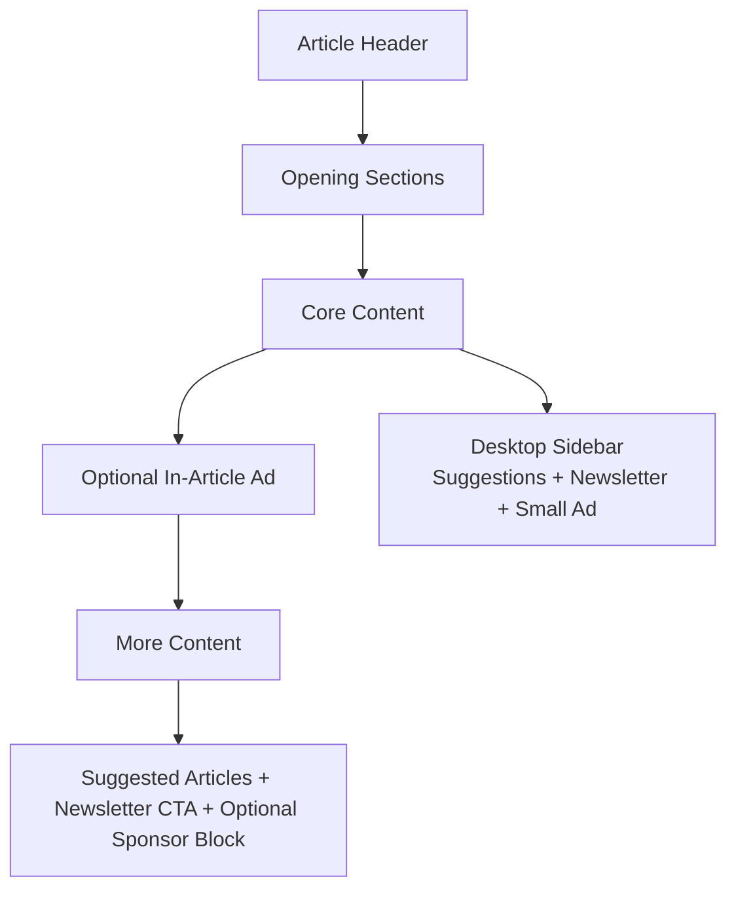
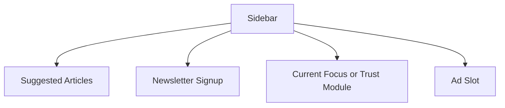

# Content and Sidebar Strategy

## Purpose
This document captures the best approach for sidebars, ad placement and article suggestion behavior during the rebuild.

## Principle
Ads and sidebars are allowed, but reading trust is non-negotiable.

The site should feel like a developer reading environment first and a monetization surface second.

## Sidebar strategy
### Where sidebars should exist
Primary recommendation:
- article detail pages on desktop,
- optional future resource-heavy educational pages.

### Where sidebars should not exist
- homepage,
- article archive,
- about page,
- contact page,
- most legal pages.

### Sidebar content priority order
If a sidebar exists, the order of value should be:
1. Suggested articles by shared tags.
2. Newsletter signup or subscribe module.
3. Small proof module or current focus block.
4. Ad slot.

The ad should never be the first useful thing in the sidebar.

## Article suggestion strategy
Suggested articles should be based on content relevance.

Priority logic:
1. shared tags,
2. shared category,
3. shared topic series,
4. recency if scores are tied.

This improves reading depth and page chains more than date-only suggestions.

## Ad strategy
### Supported ad philosophy
Ads should be:
- sparse,
- high-intent,
- visually separated,
- clearly secondary to content,
- and stable in layout to reduce CLS risk.

### Recommended ad zones
#### Zone A: Article sidebar ad
Use on desktop only. This is the least disruptive default ad placement.

#### Zone B: In-article ad after early comprehension point
Place after a meaningful amount of content, not immediately after the intro.

#### Zone C: End-of-article ad or sponsor block
Can sit near related content or the CTA section.

#### Zone D: Resource page or affiliate blocks
Better for monetization than randomly injecting many ads into educational pages.

### Avoid these ad patterns
- ad immediately below the article title,
- more than one large ad above the fold,
- ad between every two sections,
- ad layout that shifts content after load,
- and ad styling that mimics content cards too closely.

## Ad-safe layout visualization

## Suggested sidebar module stack

## Affiliate and resource strategy
Developer audiences often respond better to contextual recommendations than generic ads.

Good use cases:
- tool comparison pages,
- setup pages,
- workflow pages,
- books and resources pages,
- and curated recommendation modules.

Rules:
- disclose affiliate relationship clearly,
- recommend only tools you have used or can defend,
- prefer trust over short-term click volume.

## Exit condition for monetization layout
A monetized page is acceptable only if:
- reading comprehension remains strong,
- the page does not feel cluttered,
- CLS remains controlled,
- and suggestions still outperform ad distraction.

## Related
- Newsletter and trust loop: `newsletter-and-trust-loop.md`.
- Article suggestion display: `../design-system/ux-patterns.md`.
- Affiliate event tracking: `analytics-instrumentation.md`.
- Ad-safe acceptance gates: `acceptance-checklists.md`.
