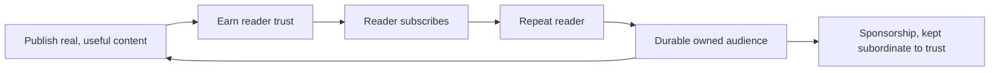

# Newsletter and Trust Loop

> The strategy for turning readers into a durable, owned audience. The newsletter is the channel. It is planned, not launched yet, so cadence and platform are open decisions below.

## The trust loop
The site runs a simple loop. Good content earns trust. Trust turns readers into subscribers. Subscribers become repeat readers. A durable audience is what makes sponsorship possible without damaging trust.

The loop only holds if each step is earned. Skipping straight to the ask breaks it.

## The newsletter's role
- The newsletter is the **owned** audience channel. It is not rented from a social algorithm, and it is the one relationship the site fully controls.
- **Status: planned, not launched.** The list, platform and cadence are not set up yet.
- **Content: a mix.** A digest of new posts with a short personal note, plus the occasional original essay or a small set of curated links with commentary.

## What it is for
- **Grow a durable owned audience.** An email list outlasts any single platform.
- **Turn one-time readers into repeat readers.** Bring people back to the next piece.
- **Enable sponsorship later.** A trusted audience can support sponsorship without the site feeling like an ad channel.

## Conversion path
From reader to subscriber:
- One clear newsletter call-to-action per article, and one in the sidebar on desktop. Never more (see `content-and-sidebar-strategy.md`).
- Lead with the value: what they get, how often and an honest "no spam, unsubscribe anytime".
- Track the signup with the `Newsletter Signup` event and its `source` and `placement` props (see `analytics-instrumentation.md`).
- Use the newsletter microcopy in `../design-system/microcopy.md`.

## Trust rules
These protect the loop:
- Value before the ask. Earn the subscribe, do not beg for it.
- Never sell or share the list.
- Sponsorship stays subordinate to reading trust, and is always disclosed.
- Once a cadence is promised, keep it. Honesty about frequency matters more than frequency itself.

## Open decisions
- **Cadence.** Deferred until the newsletter is actively set up.
- **Email platform.** Not decided. Candidates include Substack, Buttondown, ConvertKit or a Resend-backed self-hosted list. Prefer one that keeps the list portable and exportable, in line with the local-first, own-your-data value.
- **Distribution mirror.** Whether to also mirror issues on a platform like Substack or a LinkedIn newsletter for reach.

## Related
- Newsletter placement and sidebar: `content-and-sidebar-strategy.md`.
- Signup event tracking: `analytics-instrumentation.md`.
- Newsletter CTA copy: `../design-system/microcopy.md`.
- Brand goals: `../brand/brand-strategy.md`.
