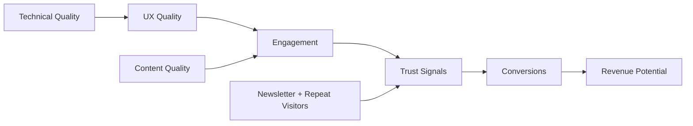

# Quality Bar and Performance Indicators

## Purpose
This document defines:
- the quality bar required before launch,
- the KPIs used to evaluate the site after launch,
- and the review cadence for judging whether the rebuilt system is actually working.

This is not only a rebuild exit document. It is also the ongoing evaluation document for the site.

## Quality bar
### Design and UX launch criteria
1. All four primary tabs are redesigned and consistent.
2. Homepage clearly communicates positioning and routes users effectively.
3. Article pages provide a strong reading experience on desktop and mobile.
4. Projects section communicates proof, not just links.
5. About page communicates credibility without visual clutter.
6. Contact flow is clear, intentional and working.

### Technical launch criteria
1. Canonical host is consistent across metadata, sitemap and robots.
2. Sitemap includes only valid routes.
3. SearchAction is removed or backed by a real search route.
4. Contact page has proper metadata.
5. Static build succeeds cleanly.
6. No new severe accessibility or lint regressions caused by rebuild work.

### Content system launch criteria
1. Related articles are working on article pages.
2. Newsletter CTA exists and is usable.
3. Project pages or project cards clearly communicate outcomes.
4. Footer and internal navigation support future pillar growth.

### Monetization launch criteria
1. Ad placements do not damage readability.
2. No aggressive layout shifts caused by ads.
3. Affiliate or sponsor surfaces are disclosed clearly.
4. Sidebar policy is respected page-by-page.

## Performance indicator set
### Traffic and engagement
- monthly unique visitors,
- returning visitor rate,
- article page scroll depth,
- time on article,
- click-through to related content.

### Trust and distribution
- newsletter subscribers,
- newsletter open rate,
- newsletter click rate,
- direct traffic growth,
- referral quality from social or search.

### Conversion
- newsletter signup rate,
- contact form completion rate,
- collaboration inquiry rate,
- affiliate CTR,
- future course waitlist conversion.

### Content system health
- publishing consistency,
- percent of articles linked to related content,
- percent of projects upgraded to case-study quality,
- number of papershelf and bookshelf entries published.

## Indicator graph

## Launch gate
Launch when:
- Priority 0 technical issues are fixed,
- the core reading experience is stronger than the current site,
- and the new system is easier to expand than the old one.

## Review cadence
- 2 weeks after launch: UX and bug review.
- 1 month after launch: engagement and SEO review.
- 3 months after launch: trust loop and monetization readiness review.

## Evaluation rule for future agents
When judging site quality, do not stop at launch readiness.

Also evaluate:
- whether users are returning,
- whether readers move deeper through the content graph,
- whether trust signals are improving,
- and whether monetization remains secondary to reading quality.

## Related
- Analytics and events: `analytics-instrumentation.md`.
- Launch exit criteria: `exit-criteria-and-metrics.md`.
- Per-page ship gates: `acceptance-checklists.md`.
