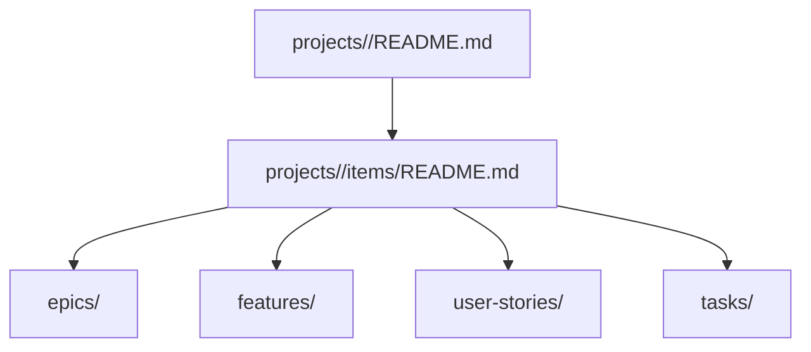

# Project Work Item Standard

## Purpose
This document defines the required front matter for any project-level work file.

Use it for epics, features, user stories, and tasks.

## Relationship to skills
The project-workspace-management skill uses this document as the authoritative work-item schema.
Keep the schema here because it is long-lived, even though the files it governs live under `projects/`.

## Item graph


## Required front matter
```yaml
---
title: Short human-readable title
project: project-name
type: epic | feature | user-story | task
status: draft | planned | in-progress | blocked | done | archived
---
```

## Recommended front matter
```yaml
---
title: Short human-readable title
project: project-name
type: epic | feature | user-story | task
status: draft | planned | in-progress | blocked | done | archived
area: optional grouping label such as reference, strategy, execution, or content
priority: optional priority label or number
parent: optional parent item title or file name
owner: optional owner or reviewer name
source: optional link or note describing where the item came from
updated: optional date in YYYY-MM-DD format
---
```

## Execution-rich front matter (Option 3)
Use this profile when items must support full dependency mapping, duration rollups, and timeline planning.

```yaml
---
title: Short human-readable title
project: project-name
type: epic | feature | user-story | task
status: draft | planned | in-progress | blocked | done | archived
id: stable identifier like E-01, F-04, US-F4-02, T-F4-02-01
area: optional grouping label such as foundation, core-surfaces, trust-monetization, growth-evaluation, or stabilization
priority: optional priority label such as P0, P1, P2
parent: optional parent item identifier
owner: optional owner name
source: optional source document or section
updated: date in YYYY-MM-DD format
estimate_days: numeric estimate for this item
size: XS | S | M | L | XL
depends_on: optional list of item identifiers this item depends on
blocks: optional list of item identifiers this item unlocks
phase: optional execution phase label
milestone: optional milestone label such as M1 through M5
target_window: optional date window such as 2026-08-24 to 2026-10-18
acceptance: short completion condition
risk: optional risk label low | medium | high
sequence: optional integer order within siblings
---
```

## Type-specific requirements for Option 3
- `epic` should include: `id`, `estimate_days`, `depends_on`, `milestone`.
- `feature` should include: `id`, `parent`, `estimate_days`, `depends_on`.
- `user-story` should include: `id`, `parent`, `estimate_days`, `acceptance`.
- `task` should include: `id`, `parent`, `estimate_days`, `size`, `depends_on`, `sequence`.

## Body guidance
The body of the file should explain:
- what the item is,
- why it exists,
- how it should work,
- and how to know when it is complete.

## Type guidance
- `epic`: a large slice of work that contains multiple items.
- `feature`: a user-visible or system-visible capability.
- `user-story`: a behavior or need from a user perspective.
- `task`: a small implementation or maintenance step.

## Status guidance
- `draft`: being shaped.
- `planned`: accepted but not started.
- `in-progress`: actively being worked on.
- `blocked`: cannot proceed yet.
- `done`: finished.
- `archived`: kept for history only.

## Rule for future agents
If a project-level file is about a unit of work, it should use this front matter.
If it is long-lived guidance, it belongs in `docs/` but not as a work item.