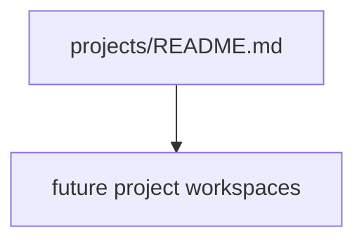

# Projects

This folder contains the active project graph for the repository.

Use it for:
- project workspaces,
- roadmaps,
- execution trackers,
- references,
- epics,
- features,
- user stories,
- and tasks.

## Project graph

## Current projects
- None. There is no active project workspace right now.

## Shared rules
- Long-lived rules live in `../docs/`.
- Project work items use the front matter standard in `../docs/work-item-standard.md`.
- Each project should have one README that explains what it is, why it exists, and how the files inside it are organized.

## What future agents should expect here
When a new project starts, add a folder beside this README and give it a README-led structure.